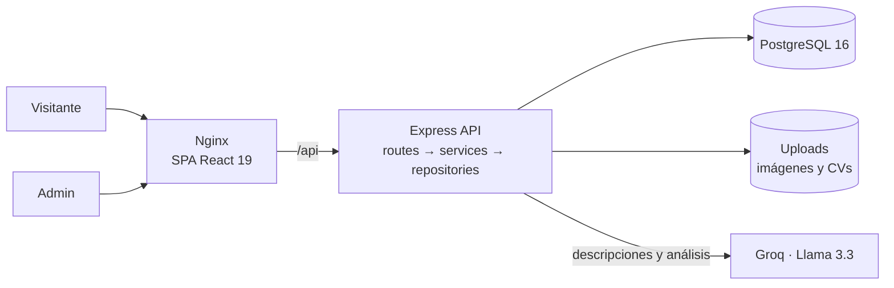

# Etán Construcciones — Sitio institucional + panel de gestión


> **Trabajo freelance para una constructora real de San Juan, Argentina.** Sitio público que presenta la empresa y un panel de administración para que el personal, sin conocimientos técnicos, gestione obras, maquinaria, búsquedas laborales y las consultas que llegan desde la web.

*English summary: freelance project for a construction company. A React 19 public website plus an admin dashboard backed by a layered Express + PostgreSQL API. It handles quote requests, contact forms, machinery rental requests and job applications (CV upload), editable content with server-side image optimization, privacy-friendly first-party analytics with cookie consent, and LLM features (Groq) to draft descriptions and explain traffic metrics. Dockerized with Nginx.*

---

## El problema

Etán tiene más de 20 años de trayectoria (demolición, piedra bola, veredas, obra civil y mantenimiento de campamentos mineros) pero **no tenía presencia web**. Los clientes nuevos —empresas mineras, municipios, particulares— llegaban sólo por referidos, y las consultas comerciales y los currículums se perdían entre llamadas y chats de WhatsApp.

## La solución

**Sitio público** con diseño editorial y fotos reales de obras:

- Inicio con servicios, línea de tiempo, contadores, obras destacadas, testimonios y carrusel de clientes.
- Páginas de **Servicios, Obras, Maquinaria, Nosotros, Empleo y Contacto**.
- Formularios de **presupuesto**, **contacto**, **alquiler de maquinaria** y **postulación con CV adjunto**.
- Modo claro y oscuro, SEO por página (`useSeo`), `sitemap.xml` y `robots.txt`.
- Banner de cookies: la analítica sólo se activa si la persona acepta.

**Panel de administración** pensado para alguien sin perfil técnico:

| Sección | Qué permite |
|---|---|
| **Bandeja** | Presupuestos, contactos, solicitudes de alquiler y postulaciones en un solo lugar, con estado de seguimiento. |
| **Contenido** | Alta, edición y baja de obras, maquinaria y búsquedas laborales con fotos. Botón de IA que redacta la descripción a partir de los datos cargados. |
| **Analítica** | Visitas por página, dispositivo, navegador y país, con gráficos. Botón de IA que interpreta las métricas y sugiere mejoras en lenguaje simple. |
| **Configuración** | Datos de contacto y textos generales del sitio, sin tocar código. |

## Decisiones técnicas

- **Backend en capas** — `routes → services → repositories → db`. Validación centralizada, errores tipados (`HttpError`) y un *middleware* único que los serializa.
- **Seguridad** — `helmet`, CORS con lista blanca, JWT + `bcrypt` para el admin, *rate limiting* separado para el login (10 intentos cada 15 min), los formularios públicos y los endpoints de IA.
- **Analítica propia y anónima** — no guarda la IP; detecta dispositivo y navegador desde el *user-agent* y toma el país sólo si el proxy lo envía. Los datos quedan en la base de la empresa, sin Google Analytics.
- **Imágenes optimizadas en el servidor** con `sharp` al subirlas desde el panel.
- **IA detrás del backend** — la clave de Groq nunca llega al navegador; los endpoints de IA del panel requieren sesión y tienen su propio límite de uso. Si la clave no está configurada, el sistema responde con un mensaje claro y el resto del sitio sigue funcionando.
- **Build multi-etapa** — Node compila el frontend y Nginx sirve los estáticos con compresión, caché y *fallback* de rutas para la SPA.

## Arquitectura



## Stack

| Capa | Tecnologías |
|---|---|
| Frontend | React 19, Vite 7, React Router 7, Framer Motion, Recharts, Sass |
| Backend | Node.js (ESM), Express 4, `pg`, JWT, bcrypt, Multer, sharp, helmet, express-rate-limit |
| Base de datos | PostgreSQL 16 (10 tablas, esquema en [`backend/schema.sql`](backend/schema.sql)) |
| IA | Groq API (Llama 3.3 70B) |
| Infraestructura | Docker Compose (db + backend + web), Nginx |

## Levantar el proyecto

### Con Docker

```bash
git clone https://github.com/SoyMonardez/Et-n_portafolio_empresa.git
cd Et-n_portafolio_empresa
cp .env.docker.example .env      # definir PGPASSWORD y JWT_SECRET
docker compose up -d --build     # → http://localhost:8090
```

La base se inicializa sola con `backend/schema.sql`. Crear el usuario administrador:

```bash
docker compose exec backend node scripts/createAdmin.js <usuario> <contraseña>
```

### Sin Docker

Requisitos: Node.js 18+ y PostgreSQL.

```bash
# API
cd backend
cp .env.example .env             # datos de PostgreSQL, JWT_SECRET y (opcional) GROQ_API_KEY
npm install
psql -d etan -f schema.sql
node scripts/createAdmin.js <usuario> <contraseña>
node scripts/seedContenido.js    # (opcional) contenido de ejemplo
npm run dev

# Frontend (otra terminal)
cd ..
npm install
npm run dev
```

### Variables de entorno principales

| Variable | Para qué |
|---|---|
| `PGHOST`, `PGPORT`, `PGUSER`, `PGPASSWORD`, `PGDATABASE` | Conexión a PostgreSQL |
| `JWT_SECRET` | Firma de la sesión del admin |
| `CORS_ORIGINS` | Orígenes permitidos |
| `UPLOAD_DIR`, `UPLOAD_MAX_MB` | Carpeta y tamaño máximo de archivos |
| `CONTACT_RATE_MAX`, `CONTACT_RATE_WINDOW_MIN` | Límite de envíos de formularios por IP |
| `GROQ_API_KEY`, `GROQ_MODEL` | Funciones de IA del panel (opcional) |

## Estructura

```
src/
  pages/            Inicio, Servicios, Obras, Maquinaria, Nosotros, Empleo, Contacto, Presupuesto
  components/       inicio/, layout/, marca/, ui/, util/ (cookies, analítica, SEO)
  admin/            Bandeja, Contenido, Analítica, Configuración
  hooks/ lib/       acceso a la API, SEO, configuración
backend/
  src/routes/       endpoints públicos y del admin
  src/services/     reglas de negocio, IA, analítica, validación
  src/repositories/ consultas SQL
  src/middlewares/  auth, rate limit, errores
  schema.sql        esquema de la base
  scripts/          createAdmin, seedContenido
docker-compose.yml  db + backend + web (Nginx)
```

## Autor

**Alejo Monárdez** — proyecto freelance desarrollado de punta a punta: relevamiento con el cliente, diseño, frontend, backend, base de datos y despliegue.

[Portfolio](https://alejomonardez.com) · [LinkedIn](https://www.linkedin.com/in/alejo-monardez/) · [GitHub](https://github.com/SoyMonardez)
